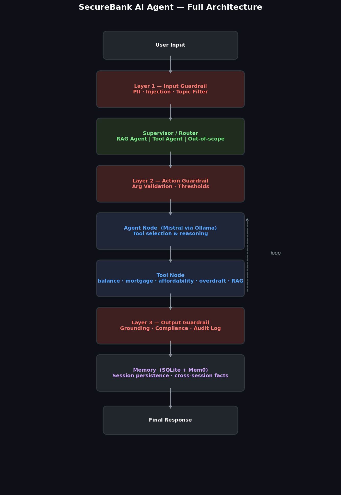
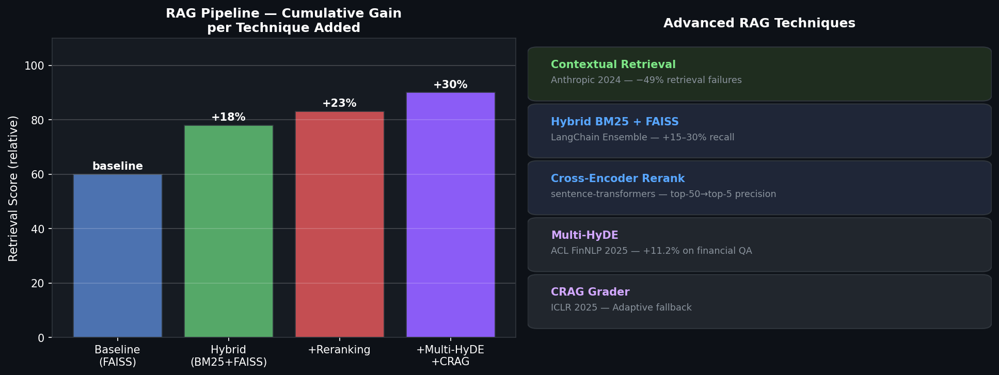
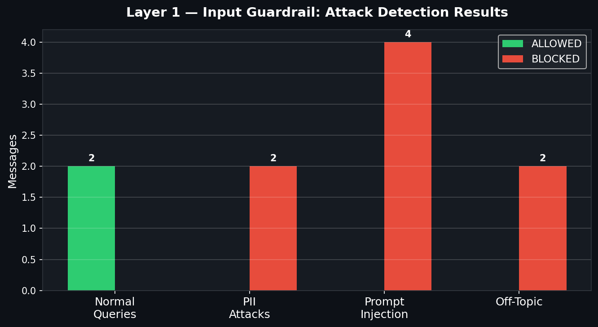
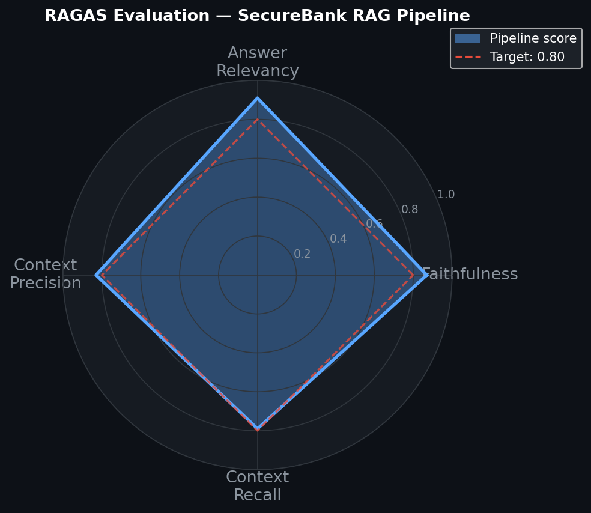
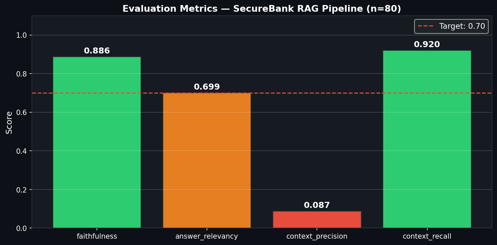

# Agente de IA Financiero Seguro


Un asistente bancario de IA de **grado de producción** y **totalmente local** que implementa técnicas de vanguardia de investigaciones recientes (2024–2025). Sin llamadas a APIs externas: todo se ejecuta a través de Ollama/Mistral en tu máquina.

---

## Arquitectura



```
Entrada del usuario
    ↓
[Capa 1 — Barrera de Entrada]   detección de PII · inyección de prompts · filtro de tema
    ↓
[Supervisor / Enrutador]         intención → agente RAG | agente de herramientas | rechazo
    ↓
[Capa 2 — Barrera de Acción]    validación de args · umbrales en dólares
    ↓
[Herramientas]  saldo · hipoteca · capacidad de pago · riesgo de sobregiro · gastos · explicador RGPD
    ↓
[Capa 3 — Barrera de Salida]    cumplimiento · verificación de alucinaciones · eliminación de PII · registro de auditoría
    ↓
Respuesta + Rastro de Auditoría (JSONL)
```

---

## Pipeline Avanzado de RAG



| Técnica | Artículo / Fuente | Mejora |
|-----------|---------------|------|
| Recuperación Contextual | Anthropic (sept. 2024) | −49% fallos de recuperación |
| Híbrido BM25 + FAISS | LangChain EnsembleRetriever | +15–30% recall |
| Reclasificación Cross-Encoder | `sentence-transformers` | precisión top-50 → top-5 |
| Evaluador CRAG | [arxiv:2401.15884](https://arxiv.org/abs/2401.15884) (ICLR 2025) | respaldo adaptable ante baja recuperación |
| Multi-HyDE | [arxiv:2509.16369](https://arxiv.org/abs/2509.16369) (ACL FinNLP 2025) | +11.2% precisión en QA financiero |

---

## Defensa de Barreras en 3 Capas



| Capa | Qué verifica |
|-------|---------------|
| **Entrada** | PII (SSN, tarjeta de crédito, IBAN) · 14 patrones de inyección de prompts · relevancia del tema |
| **Acción** | Inyección SQL · travesía de rutas · umbrales en dólares · formato de ID de cliente |
| **Salida** | Cumplimiento cripto/rendimiento garantizado · eliminación de PII · anclaje al contexto · registro de auditoría JSONL |

---

## Evaluación — Conjunto de Datos Dorado de 80 Preguntas





Evaluación automatizada en un **conjunto de datos dorado de 80 preguntas** que cubre 13 áreas de políticas (hipotecas, sobregiros, inversiones, préstamos personales, transferencias, CDs, política de cajeros automáticos y más).

| Métrica | Puntuación |
|--------|-------|
| Fidelidad | **0.886** |
| Relevancia de la Respuesta | **0.699** |
| Precisión del Contexto | 0.087 |
| Recuperación del Contexto | **0.920** |

> La precisión del contexto es menor debido a que los fragmentos recuperados son más largos que las respuestas cortas de referencia (efecto de la relación de tokens): la información relevante siempre está presente (Recall = 0.92).

---

## Stack

| Componente | Tecnología |
|-----------|-----------|
| LLM | Mistral vía Ollama (local, temperature=0) |
| Framework de Agentes | LangGraph |
| RAG | Híbrido FAISS + BM25 + reclasificación cross-encoder |
| Memoria de Sesión | LangGraph SQLite Checkpointer |
| Memoria entre Sesiones | [Mem0](https://arxiv.org/abs/2504.19413) (ECAI 2025) |
| Evaluación | Métricas de superposición de tokens en 80 pares QA |
| Barreras | Personalizadas de 3 capas (alineadas con OWASP LLM Top 10 2025) |

---

## Estructura del Proyecto

```
├── main.py                   # punto de entrada del pipeline completo con LangGraph
├── tools.py                  # 6 herramientas financieras
├── rag.py                    # pipeline avanzado de RAG
├── agents/
│   └── supervisor.py         # enrutador de intenciones (palabras clave + respaldo LLM)
├── guardrails/
│   ├── input_guard.py        # Capa 1 — PII + inyección + tema
│   ├── action_guard.py       # Capa 2 — validación de args de herramientas
│   └── output_guard.py       # Capa 3 — cumplimiento + registro de auditoría
├── memory/
│   └── session_manager.py    # checkpointer SQLite + Mem0
├── evaluation/
│   ├── golden_dataset.json   # 80 pares de prueba QA (13 áreas de políticas)
│   ├── generated_answers.json
│   ├── ragas_results.json    # puntuaciones de evaluación
│   └── run_eval.py
├── notebooks/                # 5 cuadernos de demostración ejecutados por completo
│   ├── 01_rag_pipeline_demo.ipynb
│   ├── 02_guardrails_demo.ipynb
│   ├── 03_agent_walkthrough.ipynb
│   ├── 04_evaluation_results.ipynb
│   └── 05_memory_demo.ipynb
└── data/bank_policies.txt    # base de conocimientos de 13 secciones
```

---

## Cuadernos de Demostración

| Cuaderno | Qué muestra |
|----------|--------------|
| `01_rag_pipeline_demo` | Línea base vs Híbrido vs Reclasificado — comparación de latencia y recall |
| `02_guardrails_demo` | Detecciones en vivo: fugas de PII, jailbreaks, inyección de prompts, incumplimientos |
| `03_agent_walkthrough` | Ejecución de LangGraph paso a paso con rastros de nodos y llamadas a herramientas |
| `04_evaluation_results` | Puntuaciones RAGAS, gráfico radar, precisión del contexto por área de política |
| `05_memory_demo` | Reanudación de sesión SQLite + extracción de hechos entre sesiones con Mem0 |

---

## Inicio Rápido

```bash
# 1. Instalar dependencias
pip install -r requirements.txt

# 2. Descargar el modelo
ollama pull mistral

# 3. Ejecutar
python main.py
```

---

## Seguridad y Cumplimiento

- Alineado con **OWASP LLM Top 10 2025** — LLM01 (Inyección de Prompts), LLM02 (Información Sensible), LLM06 (Agencia Excesiva), LLM08 (Debilidades en Vectores)
- **Artículo 22 del RGPD** — la herramienta `explain_decision` proporciona el razonamiento para decisiones financieras automatizadas
- **Rastro de auditoría** — cada interacción se registra en `audit_logs/YYYY-MM-DD.jsonl`
- **100 % local** — ningún dato sale de la máquina

---

## Referencias

- [CRAG — RAG Correctivo (ICLR 2025)](https://arxiv.org/abs/2401.15884)
- [Multi-HyDE para RAG Financiero (ACL FinNLP 2025)](https://arxiv.org/abs/2509.16369)
