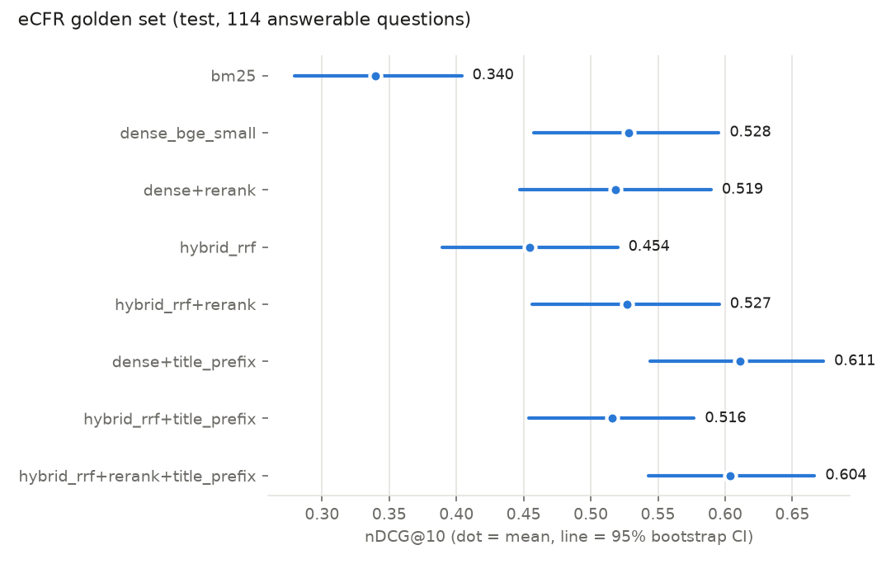
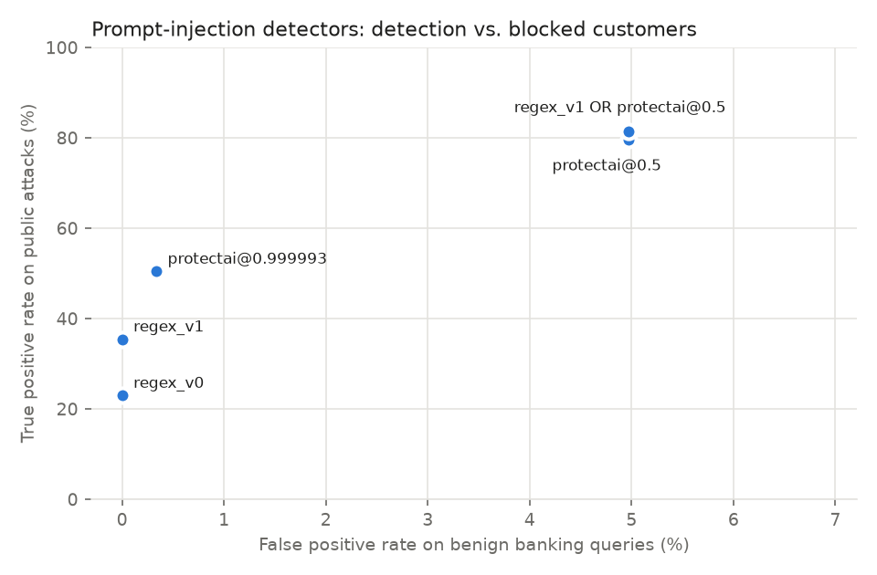

# Secure Financial AI Agent

A local banking assistant (LangGraph + Ollama) that answers questions from US consumer-banking regulations with cited
passages, runs account calculations through guarded tools, and comes with measured retrieval, guardrail, and routing
benchmarks.


## TL;DR

| Component | Result (test split, 95% CI) | Reference / baseline | Source |
|---|---|---|---|
| Retrieval on 500 pages of Reg E / DD / CC, 114 questions | **nDCG@10 0.611** [0.544, 0.673] with BGE-small + citation-title prefix | BM25 0.340 [0.280, 0.404]; dense without prefix 0.528 [0.457, 0.595] | `results/retrieval/ecfr-test.json` |
| Same pipeline on BEIR FiQA-2018 (648 queries) | nDCG@10 0.403 [0.374, 0.432] (dense), BM25 0.243 | Paper (BAAI model card, 2023): 0.403 · Paper (Thakur et al., 2021): BM25 0.236 | `results/retrieval/fiqa-test.json` |
| Hybrid BM25 + dense (RRF) and MS MARCO cross-encoder | **no gain** over dense alone on either dataset (FiQA: −0.042 and −0.022 nDCG@10, p < 0.01) | - | same files, `comparisons` |
| Prompt-injection detection, 313 public attacks / 3,596 benign queries | ProtectAI DeBERTa v2: TPR 0.796 [0.747, 0.836] at **5.0 % FPR on real banking queries** | regex (v0.1 of this repo): TPR 0.230, FPR 0.000 | `results/guardrails/injection.json` |
| PII detection, 30 hand-written hard cases | validated regex F1 0.839 · Presidio F1 0.889 | v0.1 regex F1 0.444 | `results/guardrails/pii.json` |
| Router (keyword stage) | precision 0.985 when it answers, but answers only 66 % of queries | LLM / cascade: TBD (run pending) | `results/agent/router.json` |
| End-to-end RAG with a local judge (RAGAS 0.4.3) | **TBD (run pending)** | judge validated against 50 human labels: TBD | `RUNBOOK.md` §3 |

Setup: MacBook with Apple M4, 16 GB, PyTorch MPS, Ollama; eCFR issue 2026-10-05; golden set v0 (201 LLM-drafted
questions, **not yet human-reviewed**), seeded dev/test split; bootstrap CIs over queries (2,000 resamples); paired
bootstrap for differences. Rows that need a 7B LLM have not been run yet and are marked TBD.

## Motivation

Banking assistants must quote rules exactly, refuse what they cannot ground, and never let a prompt reach another
customer's data. Most open-source "secure RAG" demos show these properties on a handful of hand-picked examples. This
project measures them: retrieval on a real regulatory corpus with a public benchmark as sanity check, injection and PII
detectors on public attack sets with false-positive rates on real customer queries, and the agent's guardrails under
red-team cases.

## Method


Every guard is a graph node (`src/secfin/agent/graph.py`), so blocked paths appear in traces and in the audit log.
Sessions are persisted with the LangGraph SQLite checkpointer.

**Corpus.** 12 CFR Parts 1005 (Reg E), 1030 (Reg DD), 229 (Reg CC) from the eCFR API, parsed into 1,277 citable
passages (paragraph level such as `1005.6(b)(1)`, or the lowest heading in the official interpretations) and 2,288
chunks of at most 1,200 characters. Gold labels refer to passages, so they do not depend on chunking.

**Retrieval components** (`src/secfin/retrieval/`):
- BM25 (Okapi, k1 = 0.9, b = 0.4, Snowball stemming), dense `BAAI/bge-small-en-v1.5` with the BGE query instruction,
  exact FAISS inner product.
- Reciprocal rank fusion (Cormack et al., 2009): `score(d) = Σ_r 1 / (60 + rank_r(d))`.
- Cross-encoder reranking of the top 50 with `cross-encoder/ms-marco-MiniLM-L-6-v2`.
- Title prefix: each chunk is indexed as `"<Regulation>, 12 CFR <passage id> - <section title>\n<text>"`.
- Contextual Retrieval (Anthropic, 2024), HyDE (Gao et al., 2022) with `v = (f(q) + Σ_k f(d̂_k)) / (N + 1)`, and a
  CRAG-style grader (Yan et al., 2024) are implemented and tested but not yet run (need Ollama, see RUNBOOK).

**Deviations from the papers.** Contextual Retrieval gets the enclosing section instead of the whole document (a part is
100k+ words). HyDE uses N = 3 Mistral 7B samples at T = 0.7 instead of 8 InstructGPT samples. CRAG uses the generator
LLM as a zero-shot evaluator instead of a fine-tuned T5, and an offline fallback (query rewrite + wider pool, then
abstention) instead of web search.

**Guardrails** (`src/secfin/guardrails/`):
- Input: injection detector (default regex v1; ProtectAI DeBERTa v2 or a union cascade selectable in
  `configs/agent.yaml`); PII is redacted before any LLM call instead of blocking the message.
- Action: argument schema per tool, customer ID must equal the authenticated session's, numeric ranges, human
  confirmation above $10M (`limits` in `configs/agent.yaml`).
- Output: compliance patterns (crypto recommendations, guaranteed returns), PII scrub, and **numeric grounding**: every
  dollar amount, percentage, or day/month/year count in the answer must occur in the retrieved text or tool output. RAG
  answers get a warning; tool answers with unverified figures are withheld.
- Audit: JSONL with a salted SHA-256 of the input, route, tool decisions, flags, citations. No raw user text.

## Experimental protocol

| Data | Size | Use | Notes |
|---|---|---|---|
| eCFR corpus | 1,277 passages, ~249k words | retrieval + RAG | public domain, SHA-256 of the raw XML in `data/corpus/manifest.json` |
| Golden set v0 | 201 questions: 146 single, 25 multi-passage, 30 unanswerable; dev 67 / test 134 | retrieval, E2E | drafted by an LLM from the passages, each with a verbatim evidence quote checked by `scripts/build_golden.py`; human review pending |
| BEIR FiQA-2018 test | 57,638 docs, 648 queries | retrieval sanity check against published numbers | CC BY-SA 4.0 |
| Injection test | 313 attacks (deepset test, Gandalf test, jackhhao jailbreaks) + 3,596 benign (Banking77 test, golden questions, deepset/jackhhao benign) | detectors | dev split (deepset train, Gandalf validation, 1,000 Banking77 train) used only to pick the 1 %-FPR threshold |
| PII | 600 templated EN/FR messages (seed 7) + 30 hand-written hard cases | detectors | templates written by the same author as the regex |
| Router | 301 queries (dev 101 / test 200) | routing accuracy | golden questions + hand-written TOOL / OUT_OF_SCOPE queries |
| Agent | 20 tool-selection, 10 red-team, 3 indirect-injection cases | tool calling | `data/agent/tool_cases.yaml` |

Metrics: Recall@k = |gold ∩ top-k passages| / |gold| after de-duplicating chunks to passages; MRR@10; nDCG@10 with
binary gains (graded BEIR qrels on FiQA). Injection: TPR on attacks, FPR on benign, Wilson 95 % intervals, exact
McNemar test between detectors. PII: entity-level precision / recall with overlap matching. E2E (pending): RAGAS
faithfulness, answer relevancy, context precision (LLM-judged, with reference), context recall, all with a local judge
(`qwen2.5:7b`) through Ollama's OpenAI-compatible endpoint; judge failures are recorded as missing, not as 0; plus
abstention rate on unanswerable questions and a deterministic passage recall of the 5 contexts.

Hyperparameters live in `configs/` (`retrieval/ablation.yaml`, `agent.yaml`, `e2e.yaml`, `corpus.yaml`). Retrieval and
detectors are deterministic, so no seeds are involved; LLM rows with sampling (HyDE, agent at T = 0.7) use seeds 0, 1, 2.

## Results

### Retrieval ablation



eCFR golden set, test split (114 answerable questions), from `results/retrieval/ecfr-test.json` via `results/tables.md`:

| Variant | nDCG@10 [95% CI] | Recall@5 | Recall@20 | MRR@10 | p50 / p90 latency (ms) |
|---|---|---|---|---|---|
| bm25 | 0.340 [0.280, 0.404] | 0.442 | 0.683 | 0.288 | 1 / 1 |
| dense_bge_small | 0.528 [0.457, 0.595] | 0.674 | 0.823 | 0.468 | 7 / 8 |
| dense+rerank | 0.519 [0.447, 0.589] | 0.656 | 0.810 | 0.465 | 182 / 200 |
| hybrid_rrf | 0.454 [0.389, 0.520] | 0.556 | 0.823 | 0.400 | 9 / 9 |
| hybrid_rrf+rerank | 0.527 [0.457, 0.596] | 0.656 | 0.823 | 0.475 | 190 / 207 |
| **dense+title_prefix** (used by the agent) | **0.611 [0.544, 0.673]** | 0.734 | 0.908 | 0.557 | 7 / 10 |
| hybrid_rrf+title_prefix | 0.516 [0.454, 0.577] | 0.668 | 0.877 | 0.442 | 9 / 9 |
| hybrid_rrf+rerank+title_prefix | 0.604 [0.543, 0.667] | 0.775 | 0.908 | 0.541 | 209 / 232 |
| dense+contextual | TBD (run pending) | | | | |
| hybrid_rrf+rerank+contextual | TBD (run pending) | | | | |
| dense+title_prefix+hyde3 | TBD (run pending) | | | | |
| dense+title_prefix+crag | TBD (run pending) | | | | |

BEIR FiQA-2018, test (648 queries), from `results/retrieval/fiqa-test.json`:

| Variant | nDCG@10 [95% CI] | Recall@5 | Recall@20 | MRR@10 | p50 / p90 latency (ms) | Paper |
|---|---|---|---|---|---|---|
| bm25 | 0.243 [0.218, 0.267] | 0.235 | 0.382 | 0.303 | 32 / 52 | 0.236 (Thakur et al., 2021) |
| dense_bge_small | 0.403 [0.374, 0.432] | 0.381 | 0.543 | 0.488 | 9 / 10 | 0.403 (BAAI bge-small-en-v1.5 model card, MTEB) |
| dense+rerank | 0.381 [0.353, 0.410] | 0.376 | 0.530 | 0.452 | 300 / 347 | - |
| hybrid_rrf | 0.362 [0.336, 0.389] | 0.348 | 0.533 | 0.432 | 48 / 69 | - |
| hybrid_rrf+rerank | 0.374 [0.347, 0.402] | 0.381 | 0.526 | 0.445 | 385 / 440 | - |
| dense+hyde3 | TBD (run pending) | | | | | HyDE + Contriever 0.273 vs Contriever 0.245 (Gao et al., 2022) |

Latency: batch size 1, 5 warm-up queries excluded, M4 with MPS for the encoder and cross-encoder, FAISS on one CPU
thread. Paper numbers use different hardware and toolkits and are shown only to check that this implementation
reproduces them.

What the ablation shows (paired bootstrap on per-query nDCG@10, `comparisons` in the result files):
- **Title prefix helps.** dense+title_prefix vs dense: +0.083 [+0.034, +0.133] on test, +0.064 [−0.003, +0.134] on dev.
- **Hybrid fusion hurts here.** hybrid_rrf vs dense: −0.074 on eCFR test (p = 0.003) and −0.042 on FiQA (p < 0.001).
  BM25 is 0.19 nDCG below dense on eCFR, and equal-weight RRF lets its errors into the top 10.
- **The MS MARCO MiniLM cross-encoder does not help** on either dataset and costs ~25× the latency. It was trained on
  web search queries, and both corpora are out of domain for it.
- **Choice for the agent.** On dev, the full hybrid+rerank+title stack is +0.041 over dense+title (p = 0.23); on test
  it is −0.008 (p = 0.79). The cheaper dense+title row is used (`configs/agent.yaml`).

Error analysis (dense+title_prefix, test): multi-passage questions reach Recall@5 0.559 vs 0.765 for single-passage
questions. 8 / 114 questions have no gold passage in the top 20. The failures fall into three types:
1. Short list items such as `229.12(b)(1) "(1) A local check;"` match many queries, because the citation prefix
   dominates their embedding. "Within what time must a lawsuit for a Regulation CC availability violation be filed?"
   retrieves them instead of `229.21(d)`.
2. The Reg CC commentary (Appendix E) is long and repetitive and crowds out the regulation text on damages questions
   (`229.21(a)(2)`).
3. Topically adjacent passages outrank the specific rule. For "How precisely must the APY be stated?" the top 5
   are APY advertising and disclosure rules (`1030.8(b)`, `1030.3(e)`), not the rounding rule `1030.3(f)`.

The human review should also check each miss for a second passage that answers the question and is missing from the
gold list. No such case was confirmed among the 8 misses above.

### Prompt-injection detection



Test split, from `results/guardrails/injection.json`:

| Detector | TPR (attacks) [95% CI] | FPR all benign | FPR Banking77 + golden [95% CI] | TPR without jackhhao |
|---|---|---|---|---|
| regex_v0 (original v0.1 patterns) | 0.230 [0.187, 0.280] | 0.0000 | 0.0000 [0.0000, 0.0012] | 0.122 |
| regex_v1 (default in the agent) | 0.355 [0.304, 0.409] | 0.0000 | 0.0000 [0.0000, 0.0012] | 0.320 |
| protectai@0.5 | 0.796 [0.747, 0.836] | 0.0467 | 0.0497 [0.0428, 0.0577] | 0.779 |
| protectai@0.999993 (dev FPR ≤ 1 %) | 0.505 [0.450, 0.560] | 0.0031 | 0.0034 [0.0019, 0.0060] | 0.674 |
| regex_v1 OR protectai@0.5 | 0.815 [0.768, 0.854] | 0.0467 | 0.0497 [0.0428, 0.0577] | 0.785 |

- ProtectAI catches all Gandalf "ignore instructions" attacks (1.000) but 0.367 of deepset attacks. Those are mostly
  role-play ("act as an interviewer"), task hijacking, and German text; the model card says it is English-only and
  does not target jailbreaks.
- Its 5 % false positives on Banking77 are short card-tracking and card-linking requests ("What is the tracking number
  for the card you sent?"). In a bank, that means about 1 customer in 20 gets refused.
- Exact McNemar on overall accuracy: ProtectAI@0.5 vs regex_v0, p = 0.67. On a benign-heavy stream the extra
  detections are cancelled by the false positives. The agent therefore defaults to regex_v1 and relies on the action
  and output guards for what it misses. This is a deliberate trade-off, not a claim that regex is a good detector.
- `jackhhao/jailbreak-classification` is in ProtectAI's training data; the last column excludes it.
- The v1 regex additions were written after seeing about 10 examples from the first rows of the Gandalf and deepset
  training splits; the test splits were not inspected before the run.
- Latency per message, batch 1 on MPS: regex 0.01 ms p50; ProtectAI 20 ms p50 / 84 ms p90.

### PII detection

From `results/guardrails/pii.json`:

| Detector | Synthetic P / R / F1 (600 msgs) | Stress P / R / F1 (30 hand-written) | Messages flagged among 200 PII-free messages | p50 latency (ms) |
|---|---|---|---|---|
| regex_v0 (v0.1) | 0.508 / 0.460 / 0.483 | 0.444 / 0.444 / 0.444 | 99 | 0.00 |
| regex_v1_validated | 1.000 / 1.000 / 1.000 | 1.000 / 0.722 / 0.839 | 0 | 0.01 |
| presidio (pattern recognizers, en_core_web_sm) | 0.868 / 0.900 / 0.884 | 0.889 / 0.889 / 0.889 | 54 | 2.83 |

The 1.000 on the synthetic set is not evidence of real-world performance: the templates and the regex were written by
the same author. On the stress set the validated regex misses:
- dotted card numbers (`4111.1111.1111.1111`);
- lowercase IBANs;
- SSNs without dashes;
- phone numbers without separators.

Presidio misses dotted cards and labels an SSN and a routing number as phone numbers. The v0.1 regex flagged 99 of 200
PII-free messages (9-digit amounts, transfer references, dates), which would have blocked those customers.

### Router

From `results/agent/router.json` (test, 200 queries):

| Router | Accuracy [95% CI] | Coverage | Accuracy when answering | p50 latency (ms) |
|---|---|---|---|---|
| keyword | 0.645 [0.580, 0.715] | 0.66 | 0.985 | 0.0 |
| llm | TBD (run pending) | | | |
| cascade (keyword → llm) | TBD (run pending) | | | |

### End-to-end RAG and judge validation

| Generator | Faithfulness | Answer relevancy | Context precision | Context recall | Abstains on unanswerable | False abstention |
|---|---|---|---|---|---|---|
| mistral (7B) | TBD (run pending) | | | | | |
| llama3.1:8b | TBD (run pending) | | | | | |
| qwen2.5:7b (self-judged) | TBD (run pending) | | | | | |

Judge (`qwen2.5:7b`) vs 50 human faithfulness labels: TBD (run pending, `scripts/judge_agreement.py`).

The pipeline was checked end to end on 3 questions (not reported as results). In that check the judge gave
faithfulness 1.0 to an answer that misread the regulation, which is why judge agreement is measured before any
faithfulness number is reported.

### Agent tool calling

TBD (run pending, `scripts/bench_agent.py`). Observations from manual runs with Mistral 7B (not a benchmark):
- With a system message, Mistral via Ollama often described tool calls in prose, or printed `[TOOL_CALLS]` as text,
  instead of emitting native calls. In one run it invented a balance for another customer.
- Three changes made the manual runs work:
  - moving a short instruction into the user turn (`tool_prompt: inline`);
  - sending only the current turn to the tool route;
  - parsing the textual `[TOOL_CALLS]` format.
- Asked for CUST456's balance by customer CUST123, the LLM did call the tool with CUST456; the action guard denied it.
- After a human declined a $20M simulation, the LLM answered with invented figures; the output guard withheld them.

These are the cases the benchmark will quantify across three seeds and three models.

## Limitations and threats to validity

- **The golden set is LLM-drafted and unreviewed.** Questions reuse regulation wording, which favours lexical matching
  and the citation-title prefix. The +0.08 title-prefix gain may shrink on customer-style paraphrases. Retrieval
  numbers on this set are not evidence about real customer queries until the review in RUNBOOK §4 is done.
- **Single annotator, same author** for the golden set, router queries, PII templates, and red-team cases. Public
  datasets (FiQA, deepset, Gandalf, jackhhao, Banking77) are the independent checks.
- **No E2E numbers yet.** RAGAS scores from a 7B local judge are only meaningful after the agreement study; until then
  this repository makes no claim about answer faithfulness.
- **Injection coverage.** No indirect-injection benchmark (e.g. BIPIA) was run; the three indirect cases in
  `data/agent/tool_cases.yaml` are a smoke test. Multilingual attacks are mostly missed by every detector tested.
- **Numeric grounding** catches invented numbers, not invented conditions without numbers. It can also pass a wrong
  number that happens to appear elsewhere in the context.
- **Regulatory content.** The corpus is a snapshot (eCFR 2026-10-05) of three regulations. It does not include
  Regulation Z (credit cards) or bank-specific terms. The demo accounts and product terms in `configs/agent.yaml` are
  fictional. This is not legal advice.
- **Latency** was measured on one laptop with other processes running; treat it as relative, not absolute.
- **Not production-ready.** Demo authentication is a header (`X-Customer-Id`). There is no rate limiting, encryption at
  rest, or load testing. The Dockerfile and docker-compose.yml are provided but have not been built or tested (not locally, not in CI).

## Reproduce

See [RUNBOOK.md](RUNBOOK.md) for every command, measured or estimated time, and output path. Summary:
- the non-LLM benchmarks take about 45 minutes on an M4;
- the LLM rows (contextual chunks, HyDE, CRAG, router, agent, E2E with a local judge) take about 2–3 nights on an M4
  and need ~14 GB of Ollama models;
- `pytest` (53 tests) needs no GPU, model download, or Ollama.

```bash
uv sync --all-extras && source .venv/bin/activate && pytest
python scripts/chat.py --customer CUST123     # needs `ollama pull mistral`
docker compose up --build                     # API on :8000 with Ollama
```

## Repository structure

```
configs/        corpus, retrieval ablation, agent, e2e configs
data/           corpus, golden set, security / router / agent sets (see data/README.md)
src/secfin/     corpus/ retrieval/ guardrails/ agent/ eval/, api.py, llm.py, runinfo.py
scripts/        build_* (data), bench_* (benchmarks), run_e2e_eval.py, judge_agreement.py, make_figures.py, chat.py
results/        committed JSON/CSV results, env.json, figures/, tables.md (generated)
tests/          pytest suite (fake LLMs; no network)
docs/           annotation guide, devlog
```

Every result file stores the full config, git SHA, date, hardware, and library versions (`src/secfin/runinfo.py`).

## References

- Thakur et al. (2021). BEIR: A Heterogeneous Benchmark for Zero-shot Evaluation of Information Retrieval Models. NeurIPS Datasets and Benchmarks. https://arxiv.org/abs/2104.08663
- Maia et al. (2018). WWW'18 Open Challenge: Financial Opinion Mining and Question Answering (FiQA). https://sites.google.com/view/fiqa
- Xiao et al. (2023). C-Pack: Packaged Resources To Advance General Chinese Embedding (BGE). https://arxiv.org/abs/2309.07597 · model card https://huggingface.co/BAAI/bge-small-en-v1.5
- Cormack, Clarke, Büttcher (2009). Reciprocal Rank Fusion outperforms Condorcet and individual rank learning methods. SIGIR.
- Robertson & Zaragoza (2009). The Probabilistic Relevance Framework: BM25 and Beyond.
- Nogueira & Cho (2019). Passage Re-ranking with BERT. https://arxiv.org/abs/1901.04085 · https://huggingface.co/cross-encoder/ms-marco-MiniLM-L-6-v2
- Anthropic (2024). Introducing Contextual Retrieval. https://www.anthropic.com/news/contextual-retrieval
- Gao, Ma, Lin, Callan (2022). Precise Zero-Shot Dense Retrieval without Relevance Labels (HyDE). https://arxiv.org/abs/2212.10496
- Yan et al. (2024). Corrective Retrieval Augmented Generation (CRAG). https://arxiv.org/abs/2401.15884
- Es et al. (2023). RAGAS: Automated Evaluation of Retrieval Augmented Generation. https://arxiv.org/abs/2309.15217 · docs https://docs.ragas.io
- OWASP (2025). Top 10 for LLM Applications. https://genai.owasp.org/llm-top-10/
- ProtectAI (2024). deberta-v3-base-prompt-injection-v2. https://huggingface.co/protectai/deberta-v3-base-prompt-injection-v2
- deepset/prompt-injections; Lakera/gandalf_ignore_instructions; jackhhao/jailbreak-classification (Hugging Face datasets).
- Casanueva et al. (2020). Efficient Intent Detection with Dual Sentence Encoders (Banking77). https://arxiv.org/abs/2003.04807
- Microsoft Presidio. https://github.com/microsoft/presidio
- LangGraph documentation (interrupts, checkpointers). https://langchain-ai.github.io/langgraph/
- eCFR API, Title 12 Parts 229, 1005, 1030. https://www.ecfr.gov/developers/documentation/api/v1
