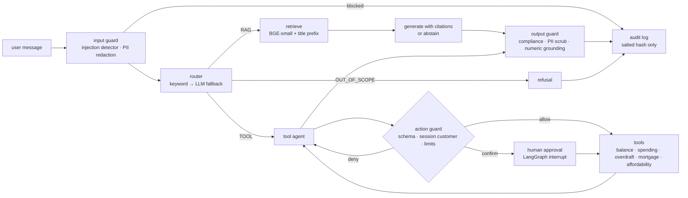
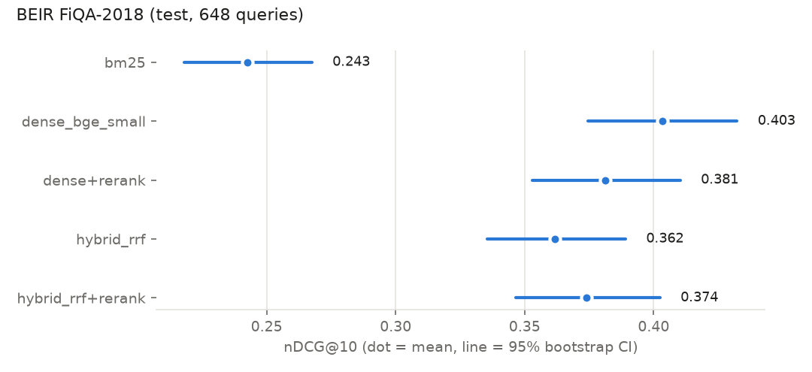

# Secure Financial AI Agent

A fully local banking assistant (LangGraph + Ollama) that answers questions from US consumer-banking regulations with
cited passages, runs account calculations through guarded tools, and backs each design decision with a benchmark.


## TL;DR

| Component | Result (test split, 95% CI) | Baseline / reference | Source |
|---|---|---|---|
| Retrieval over 500 pages of Reg E / DD / CC (114 questions) | **nDCG@10 0.611** [0.544, 0.673], Recall@20 0.908, 7 ms p50 | BM25 0.340 [0.280, 0.404] · dense without prefix 0.528 | `results/retrieval/ecfr-test.json` |
| Same retriever on BEIR FiQA-2018 (648 queries) | nDCG@10 **0.403** [0.374, 0.432] | Paper (BAAI model card, 2023): 0.403 · BM25: ours 0.243, Paper (Thakur et al., 2021) 0.236 | `results/retrieval/fiqa-test.json` |
| Hybrid BM25 + dense (RRF), MS MARCO cross-encoder | no gain over dense on either dataset (FiQA: −0.042 and −0.022 nDCG@10, p < 0.01) | - | `comparisons` in the same files |
| Prompt-injection detection (313 public attacks, 3,596 benign queries) | DeBERTa (ProtectAI v2): TPR **0.796** at **5.0 % FPR** on real banking queries | regex: TPR 0.355 at 0.0 % FPR | `results/guardrails/injection.json` |
| PII detection (30 hand-written hard cases) | Presidio F1 0.889 · validated regex F1 0.839 | naive regex F1 0.444 | `results/guardrails/pii.json` |
| Keyword router (200 queries) | precision **0.985** on the 66 % of queries it routes; the rest go to the LLM router | - | `results/agent/router.json` |
| Agent guardrails | cross-customer access denied, human approval above $10M, invented figures withheld, PII never reaches the LLM: covered by 53 offline tests | - | `tests/` |

Setup: Apple M4 (16 GB, PyTorch MPS), Ollama, eCFR issue 2026-10-05; seeded dev/test splits; bootstrap CIs over
queries (2,000 resamples); paired bootstrap and exact McNemar tests for comparisons.

## Motivation

A banking assistant has to quote rules exactly, refuse what it cannot ground, and never let a prompt reach another
customer's data. Most "secure RAG" demos show these properties on hand-picked examples. This project measures them:
- retrieval on a real regulatory corpus, cross-checked against a public benchmark;
- injection and PII detectors on public attack sets, with false-positive rates on real customer queries;
- guardrails enforced as graph nodes and tested against red-team scenarios.

## Architecture



Every guard is a node of the LangGraph graph (`src/secfin/agent/graph.py`), so blocked paths show up in traces and in
the audit log. Sessions persist through the LangGraph SQLite checkpointer. The agent is served by a CLI
(`scripts/chat.py`) and a FastAPI service (`src/secfin/api.py`).

**Corpus.** 12 CFR Parts 1005 (Reg E), 1030 (Reg DD) and 229 (Reg CC) are pulled from the eCFR API and parsed into
1,277 citable passages: regulation paragraphs such as `1005.6(b)(1)`, plus official interpretations. These become
2,288 chunks of at most 1,200 characters. Relevance labels refer to passages, so they do not depend on chunking.

**Retrieval** (`src/secfin/retrieval/`):
- **BM25.** Okapi with k1 = 0.9, b = 0.4 and Snowball stemming.
- **Dense.** `BAAI/bge-small-en-v1.5` with the BGE query instruction, exact FAISS inner product.
- **Fusion.** Reciprocal rank fusion, `score(d) = Σ_r 1 / (60 + rank_r(d))` (Cormack et al., 2009).
- **Reranking.** Cross-encoder `ms-marco-MiniLM-L-6-v2` over the top 50.
- **Citation-title prefix.** Each chunk is indexed as `"<Regulation>, 12 CFR <passage id> - <section title>\n<text>"`.
- **Optional LLM components.** Contextual Retrieval (Anthropic, 2024; Mistral generates a context per chunk), HyDE
  (Gao et al., 2022; `v = (f(q) + Σ_k f(d̂_k)) / (N + 1)`, N = 3) and a CRAG-style grader (Yan et al., 2024) with query
  rewrite and abstention. All three are switchable from `configs/retrieval/ablation.yaml`.
- The agent uses **dense + title prefix**, the simplest configuration within noise of the best one (see Results).

**Guardrails** (`src/secfin/guardrails/`):
- **Input.**
  - Injection detector: regex by default; ProtectAI DeBERTa v2 or a union cascade selectable in `configs/agent.yaml`.
  - PII is redacted before any LLM call rather than blocking the customer.
- **Action.**
  - Per-tool argument schema and numeric ranges.
  - The customer ID must equal the authenticated session's.
  - Amounts above $10M pause the graph for human approval.
- **Output.**
  - Compliance patterns (crypto recommendations, guaranteed returns) and PII scrub.
  - **Numeric grounding**: every amount, rate or deadline in an answer must occur in the retrieved text or tool
    output. Unverified figures in tool answers are withheld.
- **Audit.** JSONL with a salted SHA-256 of the input, route, tool decisions, flags and citations. The raw user text is
  never stored.

## Data and protocol

| Data | Size | Use |
|---|---|---|
| eCFR corpus (public domain) | 1,277 passages, ~249k words | retrieval, RAG |
| Golden QA set | 201 questions: 146 single-passage, 25 multi-passage, 30 unanswerable; dev 67 / test 134 | retrieval, abstention |
| BEIR FiQA-2018 test (CC BY-SA 4.0) | 57,638 docs, 648 queries | sanity check against published numbers |
| Injection sets | test: 313 attacks (deepset, Lakera Gandalf, jackhhao jailbreaks) + 3,596 benign (Banking77, golden questions); dev used only to pick a 1 %-FPR threshold | detectors |
| PII sets | 600 templated EN/FR messages + 30 hand-written hard cases | detectors |
| Routing set | 301 labelled queries (RAG / TOOL / OUT_OF_SCOPE), dev 101 / test 200 | router |
| Agent cases | 20 tool-selection, 10 red-team, 3 indirect-injection scenarios | agent benchmark |

Every golden question stores its gold passage IDs and a verbatim evidence quote, checked against the corpus by
`scripts/build_golden.py`. Sources and licenses are in [`data/README.md`](data/README.md).

**Metrics.**
- **Retrieval.** Recall@k after de-duplicating chunks to passages, MRR@10, nDCG@10 (graded BEIR qrels on FiQA).
- **Detectors.** TPR on attacks and FPR on benign queries with Wilson intervals; entity-level precision / recall for
  PII.
- **Latency.** Batch size 1, warm-up excluded, p50 / p90.

All hyperparameters are in [`configs/`](configs). Every result file records its config, git SHA, hardware and library
versions.

## Results

### Retrieval ablation

eCFR golden set, test split (114 answerable questions), `results/retrieval/ecfr-test.json`:

| Variant | nDCG@10 [95% CI] | Recall@5 | Recall@20 | MRR@10 | p50 / p90 latency (ms) |
|---|---|---|---|---|---|
| bm25 | 0.340 [0.280, 0.404] | 0.442 | 0.683 | 0.288 | 1 / 1 |
| dense_bge_small | 0.528 [0.457, 0.595] | 0.674 | 0.823 | 0.468 | 7 / 8 |
| dense+rerank | 0.519 [0.447, 0.589] | 0.656 | 0.810 | 0.465 | 182 / 200 |
| hybrid_rrf | 0.454 [0.389, 0.520] | 0.556 | 0.823 | 0.400 | 9 / 9 |
| hybrid_rrf+rerank | 0.527 [0.457, 0.596] | 0.656 | 0.823 | 0.475 | 190 / 207 |
| **dense+title_prefix** (deployed) | **0.611 [0.544, 0.673]** | 0.734 | 0.908 | 0.557 | 7 / 10 |
| hybrid_rrf+title_prefix | 0.516 [0.454, 0.577] | 0.668 | 0.877 | 0.442 | 9 / 9 |
| hybrid_rrf+rerank+title_prefix | 0.604 [0.543, 0.667] | 0.775 | 0.908 | 0.541 | 209 / 232 |

BEIR FiQA-2018, test (648 queries), `results/retrieval/fiqa-test.json`:

| Variant | nDCG@10 [95% CI] | Recall@5 | Recall@20 | MRR@10 | p50 / p90 latency (ms) | Paper |
|---|---|---|---|---|---|---|
| bm25 | 0.243 [0.218, 0.267] | 0.235 | 0.382 | 0.303 | 32 / 52 | 0.236 (Thakur et al., 2021) |
| dense_bge_small | 0.403 [0.374, 0.432] | 0.381 | 0.543 | 0.488 | 9 / 10 | 0.403 (BAAI model card, MTEB) |
| dense+rerank | 0.381 [0.353, 0.410] | 0.376 | 0.530 | 0.452 | 300 / 347 | - |
| hybrid_rrf | 0.362 [0.336, 0.389] | 0.348 | 0.533 | 0.432 | 48 / 69 | - |
| hybrid_rrf+rerank | 0.374 [0.347, 0.402] | 0.381 | 0.526 | 0.445 | 385 / 440 | - |



What the ablation shows (paired bootstrap on per-query nDCG@10):
- **The dense implementation reproduces published FiQA numbers** to the third decimal (0.403 vs 0.403), which
  validates the evaluation code.
- **The citation-title prefix is the biggest win.** It adds +0.083 [+0.034, +0.133] over plain dense on test, and the
  same direction on dev (+0.064).
- **Hybrid fusion hurts on both corpora.** RRF vs dense: −0.074 on eCFR (p = 0.003), −0.042 on FiQA (p < 0.001).
  BM25 trails dense by 0.19 nDCG on eCFR, and equal-weight fusion lets its errors into the top 10.
- **The MS MARCO cross-encoder adds nothing and costs ~25× the latency.** It was trained on web queries, and both
  corpora are out of domain for it.
- **Deployment choice.** On dev, the full hybrid+rerank+title stack is +0.041 over dense+title (p = 0.23); on test it
  is −0.008 (p = 0.79). The 7 ms dense+title configuration is deployed instead of the 209 ms stack.

Error analysis (dense+title_prefix, test): multi-passage questions reach Recall@5 0.559 vs 0.765 for single-passage
questions, and 8 / 114 questions have no gold passage in the top 20. The misses fall into three patterns:
1. **Short list items dominated by their citation prefix.** Items such as `229.12(b)(1) "(1) A local check;"` match too
   many queries.
2. **Long, repetitive commentary.** The Reg CC commentary (Appendix E) crowds out the regulation text on damages
   questions.
3. **Topically adjacent rules outrank the specific one.** For "How precisely must the APY be stated?" the APY
   advertising rules outrank the rounding rule `1030.3(f)`.

### Prompt-injection detection


Test split, `results/guardrails/injection.json`:

| Detector | TPR (attacks) [95% CI] | FPR all benign | FPR Banking77 + golden [95% CI] | TPR excl. jackhhao |
|---|---|---|---|---|
| regex (naive, 12 patterns) | 0.230 [0.187, 0.280] | 0.0000 | 0.0000 [0.0000, 0.0012] | 0.122 |
| regex (extended, 17 patterns) | 0.355 [0.304, 0.409] | 0.0000 | 0.0000 [0.0000, 0.0012] | 0.320 |
| ProtectAI DeBERTa v2 @0.5 | 0.796 [0.747, 0.836] | 0.0467 | 0.0497 [0.0428, 0.0577] | 0.779 |
| ProtectAI @ dev FPR ≤ 1 % | 0.505 [0.450, 0.560] | 0.0031 | 0.0034 [0.0019, 0.0060] | 0.674 |
| extended regex OR ProtectAI | 0.815 [0.768, 0.854] | 0.0467 | 0.0497 [0.0428, 0.0577] | 0.785 |

- **Strong on direct attacks, weak on role-play.** ProtectAI catches every Lakera Gandalf "ignore instructions" attack
  but only 0.367 of deepset attacks. Those are mostly role-play, task hijacking and German text, which its model card
  excludes.
- **Its false positives fall on ordinary card requests** ("What is the tracking number for the card you sent?"). That is
  about 1 legitimate customer in 20.
- **Overall it is not significantly more accurate than the naive regex** on a benign-heavy stream (exact McNemar,
  p = 0.67).
- **Hence the default.** The agent runs the zero-false-positive extended regex at the input, and relies on the action
  and output guards for what it misses. The DeBERTa detector is one config switch away.
- **Contamination check.** jackhhao is part of ProtectAI's training data; the last column excludes it.
- **Latency per message, batch 1.** Regex 0.01 ms; DeBERTa 20 ms p50 / 84 ms p90.

### PII detection

`results/guardrails/pii.json`:

| Detector | Synthetic P / R / F1 (600 msgs) | Hard cases P / R / F1 (30 msgs) | Messages flagged among 200 PII-free | p50 latency (ms) |
|---|---|---|---|---|
| naive regex | 0.508 / 0.460 / 0.483 | 0.444 / 0.444 / 0.444 | 99 | 0.00 |
| validated regex (Luhn, IBAN mod-97, SSA rules) | 1.000 / 1.000 / 1.000 | 1.000 / 0.722 / 0.839 | 0 | 0.01 |
| Microsoft Presidio | 0.868 / 0.900 / 0.884 | 0.889 / 0.889 / 0.889 | 54 | 2.83 |

Checksum validation removes false positives on dollar amounts, dates and transfer references. The hard cases expose
what each detector misses:
- **Validated regex.** Misses dotted card numbers, lowercase IBANs, SSNs without dashes, and phone numbers without
  separators.
- **Presidio.** Misses dotted cards and labels an SSN and a routing number as phone numbers.

### Router

Test split (200 queries), `results/agent/router.json`:

| Router | Accuracy [95% CI] | Coverage | Precision when routing | p50 latency (ms) |
|---|---|---|---|---|
| keyword stage | 0.645 [0.580, 0.715] | 0.66 | 0.985 | 0.0 |

The keyword stage is precise but abstains on a third of queries. Those queries fall through to the LLM classifier
(`router.mode: cascade`), so the expensive call only runs when the cheap one is unsure.

### Agent behaviour

The red-team scenarios run against the real graph with scripted LLM outputs (`tests/test_graph.py`), so each guard is
checked independently of model quality:
- **Prompt injection.** Blocked before any LLM call; the raw text is absent from the checkpoint and the audit log.
- **Cross-customer access.** An LLM that obeys an injected instruction and requests CUST456 from CUST123's session is
  denied by the action guard; the other balance never reaches the model.
- **Large amounts.** A $20M simulation pauses for human approval, and approve / decline both resume correctly, from
  the CLI and from the API's `/confirm` endpoint.
- **Invented numbers.** A RAG answer citing a number absent from the regulation is flagged. A tool answer with figures
  no tool produced is withheld.
- **PII.** Card numbers are redacted before the LLM sees the message.

The same behaviour holds in a live session with Mistral 7B through Ollama:
- correct tool results ($5,432.50 balance; a $6,000 payment overdraws by $567.50; $1,753.77/month on a $300k
  mortgage at 5 % over 25 years);
- a denied cross-customer request;
- a human-approval prompt for the $20M mortgage;
- a withheld answer when the model tried to improvise figures after a declined approval.

Making a 7B model call tools reliably needed three adjustments. These came out of debugging live runs:
- instructions placed in the user turn (`tool_prompt: inline`), because Mistral stops emitting native tool calls when
  a system message is present;
- only the current turn sent to the tool route;
- a parser for Mistral's textual `[TOOL_CALLS]` format.

### Evaluation harness

`scripts/run_e2e_eval.py` runs the whole RAG pipeline against the golden set and scores it with RAGAS 0.4.3 using a
**local** judge through Ollama's OpenAI-compatible endpoint, so no API key is involved:
- **Metrics.** Faithfulness, answer relevancy, context precision and context recall, plus abstention on unanswerable
  questions and a deterministic passage-recall check.
- **Judge failures are recorded as missing, never as 0.** Invalid structured output from a small judge is a known
  cause of near-zero context-precision scores.
- **Judge validation.** `scripts/judge_agreement.py` measures agreement between the judge and human faithfulness labels
  (weighted Cohen's κ).

## Limitations

- **The golden set was drafted with an LLM from the passages it labels.** Each item is verified automatically
  (verbatim evidence quote, existing gold passages). Its wording is close to the regulation, which favours lexical
  matching and the citation-title prefix.
- **Single author.** One author wrote the golden set, routing queries, PII templates and red-team cases. FiQA, the
  public injection datasets and Banking77 are the independent checks.
- **Narrow injection coverage.** Indirect injection is covered by three agent scenarios, not by a public benchmark.
  Multilingual attacks are largely missed by every detector tested.
- **Numeric grounding** catches invented numbers, not invented conditions without numbers.
- **Corpus scope.** The corpus is a dated snapshot of three regulations (no Regulation Z) and is not legal advice. The
  demo accounts and product terms in `configs/agent.yaml` are fictional.
- **Demo authentication.** The customer is taken from a request header (`X-Customer-Id`); a deployment would sit
  behind a real identity provider.

## Quickstart

```bash
uv sync --all-extras && source .venv/bin/activate
pytest                                        # 53 offline tests, no GPU / downloads / Ollama
ollama pull mistral
python scripts/chat.py --customer CUST123     # CLI; sessions persisted in sessions/checkpoints.db
uvicorn secfin.api:app --port 8000            # REST API
docker compose up --build                     # API + Ollama
```

Every table can be regenerated with the commands in [RUNBOOK.md](RUNBOOK.md) (≈45 min on an Apple M4 for the
benchmarks above).

## Repository structure

```
configs/        corpus, retrieval ablation, agent, end-to-end evaluation
data/           corpus, golden set, security / router / agent sets (see data/README.md)
src/secfin/     corpus/ retrieval/ guardrails/ agent/ eval/, api.py, llm.py, runinfo.py
scripts/        build_* (data), bench_* (benchmarks), run_e2e_eval.py, judge_agreement.py, make_figures.py, chat.py
results/        JSON/CSV results, env.json, figures/, tables.md (generated)
tests/          pytest suite with scripted LLMs
docs/           annotation guide, development log
```

## References

- Thakur et al. (2021). BEIR: A Heterogeneous Benchmark for Zero-shot Evaluation of Information Retrieval Models. https://arxiv.org/abs/2104.08663
- Maia et al. (2018). WWW'18 Open Challenge: Financial Opinion Mining and Question Answering (FiQA).
- Xiao et al. (2023). C-Pack: Packaged Resources To Advance General Chinese Embedding (BGE). https://arxiv.org/abs/2309.07597 · https://huggingface.co/BAAI/bge-small-en-v1.5
- Cormack, Clarke, Büttcher (2009). Reciprocal Rank Fusion outperforms Condorcet and individual rank learning methods. SIGIR.
- Robertson & Zaragoza (2009). The Probabilistic Relevance Framework: BM25 and Beyond.
- Nogueira & Cho (2019). Passage Re-ranking with BERT. https://arxiv.org/abs/1901.04085
- Anthropic (2024). Introducing Contextual Retrieval. https://www.anthropic.com/news/contextual-retrieval
- Gao, Ma, Lin, Callan (2022). Precise Zero-Shot Dense Retrieval without Relevance Labels (HyDE). https://arxiv.org/abs/2212.10496
- Yan et al. (2024). Corrective Retrieval Augmented Generation. https://arxiv.org/abs/2401.15884
- Es et al. (2023). RAGAS: Automated Evaluation of Retrieval Augmented Generation. https://arxiv.org/abs/2309.15217
- OWASP (2025). Top 10 for LLM Applications. https://genai.owasp.org/llm-top-10/
- ProtectAI (2024). deberta-v3-base-prompt-injection-v2. https://huggingface.co/protectai/deberta-v3-base-prompt-injection-v2
- Casanueva et al. (2020). Efficient Intent Detection with Dual Sentence Encoders (Banking77). https://arxiv.org/abs/2003.04807
- deepset/prompt-injections · Lakera/gandalf_ignore_instructions · jackhhao/jailbreak-classification (Hugging Face datasets)
- Microsoft Presidio. https://github.com/microsoft/presidio
- LangGraph documentation. https://langchain-ai.github.io/langgraph/
- eCFR API. https://www.ecfr.gov/developers/documentation/api/v1
